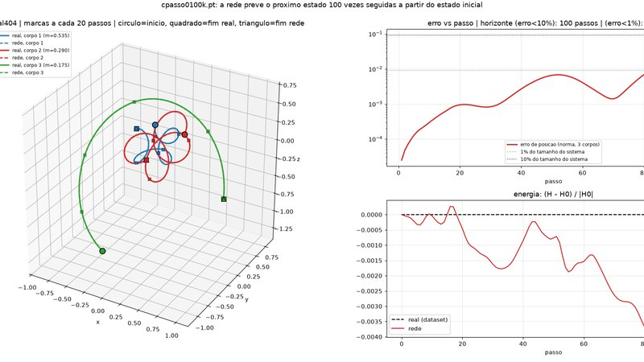
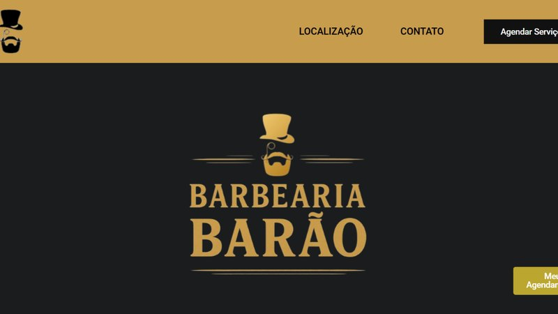
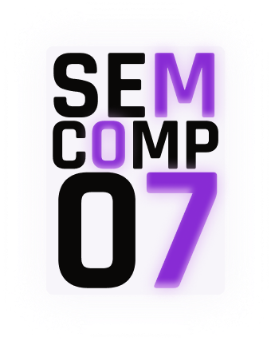

# Gabriel Hupfer Righi

**Computer Science @ USP | AI & Machine Learning | Python | Software Development**

[🌐 Academic Portfolio](https://gabrielhr77.github.io/) · [🔬 Research](https://gabrielhr77.github.io/research/) · [📂 Projects](https://gabrielhr77.github.io/portfolio/)

I'm a Computer Science undergraduate student at the **University of São Paulo (USP)**, Brazil. My main interests are at the intersection of computer science, physics, and scientific research.

My primary programming language is **Python**, which I use in scientific computing, numerical simulations, mathematical modeling, and machine learning. My research focuses on computational astrophysics and gravitational N-body systems, exploring the application of deep learning to predict complex physical dynamics.

I also have experience in web development, particularly with WordPress, website customization, and workflow automation.

---

### 📌 GitHub Overview

    

---

### Programming Languages & Technologies

**⭐ Main Programming Language**

    

**Other Programming Languages**

    
    
    
    

**Web Development**

    
    
    
    

**Scientific Computing & Machine Learning**

    
    
    

Astropy · Numerical Integration · Deep Learning · Computational Physics

**WordPress Ecosystem**

WordPress · Elementor · Elementor Pro · JetEngine · JetTabs · LatePoint · PHP Customization

**Automation & Development Tools**

    
    
    
    

n8n · Workflow Automation

---

### 🚀 Featured Projects

<!-- A selection of my work in scientific computing, machine learning, software development, and university initiatives.

#### 🔬 Gravitational Dynamics — Scientific Machine Learning

**Python · PyTorch · Transformers · Numerical Methods**

FAPESP-supported undergraduate research at the University of São Paulo, investigating neural networks for predicting gravitational N-body dynamics.

- Developed numerical simulations of gravitational systems.
- Explored autoregressive Transformers and physics-informed learning.
- Evaluated model predictions against numerical integration methods.

[Source Code](https://github.com/gabrielhr77/scientific_initiation) · [Academic Portfolio](https://gabrielhr77.github.io/portfolio/)

---

#### 🧩 ASD GameHub — Inclusive Educational Games

**Python · Kivy · Mobile Development**

Collaborative university extension project at USP focused on developing educational games designed for autistic children.

I developed **two of the application's three games**:

- **Social Understanding:** 20 interactive social scenarios with character selection and contextual feedback.
- **Daily Routines:** interactive sequencing activities based on five everyday routines.

[Team Repository](https://github.com/v1n1btt/ASD_GameHub) · [Case Study](https://gabrielhr77.github.io/portfolio/asd-gamehub/)

---

#### 🌐 Barbershop Website — Web Development

**WordPress · Elementor · JetEngine · PHP · LatePoint**

Developed and customized a barbershop website featuring service listings, professional profiles, and an appointment booking workflow.

- Customized responsive pages and interactive components.
- Integrated WordPress plugins for dynamic content.
- Worked on user navigation and booking interfaces.

[View Case Study](https://gabrielhr77.github.io/portfolio/barbershop-website/)

---

#### 🎓 VII Semana da Computação — Event Leadership

**Project Management · Team Coordination · Technology Outreach**

Served as General Director of the VII Semana da Computação at USP Ribeirão Preto.

- Coordinated approximately 20 student organizers.
- Managed event planning and collaboration across teams.
- Secured approximately BRL 5,000 in sponsorships.
- Supported the organization of technical and academic activities.

[View Academic Portfolio](https://gabrielhr77.github.io/portfolio/)

---
-->
Selected projects combining scientific research, software development, and community initiatives.

<table>
  <tr>
    <td width="50%" align="center" valign="top">
      
       <b>Gravitational Dynamics with Neural Networks</b>
       FAPESP Research · Python · PyTorch · Transformers
        
      <a href="https://gabrielhr77.github.io/portfolio/gravitational-dynamics/">Case study</a> ·
      <a href="https://github.com/gabrielhr77/scientific_initiation">Source code</a>
    </td>
    <td width="50%" align="center" valign="top">
      
       <b>ASD GameHub — Educational Games</b>
       USP Extension · Python · Kivy · Mobile Development
        
      <a href="https://gabrielhr77.github.io/portfolio/asd-gamehub/">My contributions</a> ·
      <a href="https://github.com/v1n1btt/ASD_GameHub">Team repository</a>
    </td>
  </tr>
  <tr>
    <td width="50%" align="center" valign="top">
      
       <b>Barbershop Website</b>
       WordPress · Elementor · JetEngine · Web Development
        
      <a href="https://gabrielhr77.github.io/portfolio/barbershop-website/">Case study</a>
    </td>
    <td width="50%" align="center" valign="top">
      
       <b>VII Semana da Computação</b>
       General Director · Team Leadership · Event Management
        
      <a href="https://gabrielhr77.github.io/portfolio/semcomp-platform/">Case study</a>
    </td>
  </tr>
</table>

---

### 🔬 Research Interests

- **Computational Astrophysics:** Numerical modeling and simulation of gravitational systems.
- **Gravitational N-Body Problem:** Studying multi-body interactions and orbital dynamics.
- **Scientific Machine Learning:** Applying neural networks to learn and predict physical systems.
- **Numerical Methods:** Numerical integration and differential equations.
- **Orbital Mechanics:** Orbital dynamics and interplanetary trajectories.

### 🎓 Academic Background

**University of São Paulo (USP)**  
B.Sc. in Computer Science  
Ribeirão Preto, Brazil

**Undergraduate Research — FAPESP**

Research involving gravitational dynamics, numerical simulations, computational modeling, and deep learning applications to physical systems.

---

### 🌎 Languages

| Language | Proficiency |
|:---|:---|
| 🇧🇷 Portuguese | Native |
| 🇬🇧 English | Fluent |
| 🇩🇪 German | Basic |
| 🇷🇺 Russian | Basic |

---

    <i>“Your lack of fear is based on your ignorance.”</i>
    <i>― Liu Cixin, The Three-Body Problem</i>

